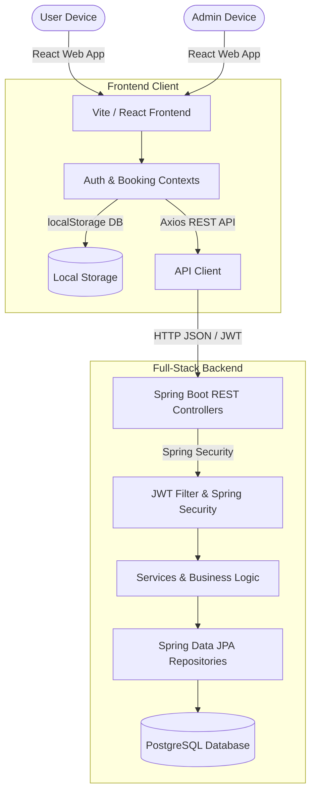

Below is a fully fleshed-out README you can paste into the root of the repository:

```md
# Smart Parking System

A modern smart parking management web application designed to simplify parking slot discovery, booking, payment simulation, ticket generation, and admin monitoring. The project combines a React + TypeScript frontend with a Java Spring Boot backend, and supports both mock/local-storage mode and full API-backed database mode.

This project was developed as a final-year college project and is designed to showcase full-stack development, UI/UX, REST API architecture, authentication, QR code integration, and business workflow design.

## Table of Contents

- [Overview](#overview)
- [Features](#features)
- [Tech Stack](#tech-stack)
- [System Architecture](#system-architecture)
- [Project Structure](#project-structure)
- [Dual-Mode Design](#dual-mode-design)
- [Prerequisites](#prerequisites)
- [Frontend Setup](#frontend-setup)
- [Backend Setup](#backend-setup)
- [Run the Application](#run-the-application)
- [Usage](#usage)
- [API Features](#api-features)
- [Database Design](#database-design)
- [Deployment Notes](#deployment-notes)
- [License](#license)
- [Contact](#contact)

---

## Overview

The Smart Parking System allows users to:

- Search for parking locations
- View slot availability
- Reserve parking slots
- Simulate or process payment
- Download/print QR-based e-tickets
- View booking history
- Cancel upcoming reservations

Admins can:

- Manage parking locations
- View analytics and revenue summaries
- Maintain slot status
- Validate bookings and tickets
- Access operations reports

The application is built with a dual-mode design:

- Mock Mode: Runs entirely on the client using localStorage for easy demo use
- API Mode: Connects to a Java Spring Boot backend and PostgreSQL database for a realistic enterprise implementation

---

## Features

### User Features
- User registration and login
- Profile management
- Vehicle registration
- Search parking locations by name or area
- View real-time/managed slot availability
- Reserve parking slots with duration selection
- Simulated payment flow
- QR code ticket generation
- Booking confirmation page
- Booking history and cancellation support
- User notifications

### Admin Features
- Admin dashboard with summary metrics
- Manage parking locations
- Add/update/delete parking data
- Slot status monitoring
- Booking validation
- QR verification simulation
- Downloadable reports/log exports
- Revenue and activity insights

### Technical Features
- Responsive UI
- Role-based access patterns
- JWT authentication support
- API-first architecture
- Database-backed backend
- QR code generation
- Local mock mode for demos
- Modular frontend structure
- Spring Boot + Maven backend setup

---

## Tech Stack

### Frontend
- React
- TypeScript
- Vite
- React Router DOM
- Tailwind CSS
- Axios
- Lucide React
- QR code generation

### Backend
- Java 17
- Spring Boot 3
- Spring Web
- Spring Data JPA
- Spring Security
- PostgreSQL
- Maven
- JWT (JSON Web Tokens)
- ZXing QR code library

### Database
- PostgreSQL

### Project Tools
- ESLint
- TypeScript compiler
- Maven build system

---

## System Architecture

The application follows a layered full-stack structure:



This allows the system to function in a lightweight demo mode while also supporting enterprise-style database integration.

---

## Project Structure

```text
smart-parking-system/
├── LICENSE
├── README.md
├── project/
│   ├── DOCUMENTATION.md
│   ├── index.html
│   ├── package.json
│   ├── package-lock.json
│   ├── vite.config.ts
│   ├── tailwind.config.js
│   ├── postcss.config.js
│   ├── eslint.config.js
│   ├── tsconfig.json
│   ├── tsconfig.app.json
│   ├── tsconfig.node.json
│   ├── src/
│   │   ├── App.tsx
│   │   ├── main.tsx
│   │   ├── index.css
│   │   ├── vite-env.d.ts
│   │   ├── components/
│   │   ├── config/
│   │   ├── context/
│   │   ├── data/
│   │   ├── pages/
│   │   └── types/
│   └── backend/
│       ├── pom.xml
│       └── src/
│           └── main/
│               ├── java/
│               └── resources/
```

---

## Dual-Mode Design

### 1. Mock Mode (Default)
The frontend can operate without a backend using browser `localStorage` as a pseudo-database. This makes the app easy to run and demo on a presentation machine with no external server setup.

### 2. API Mode
The application can be switched to a real backend mode using Spring Boot + PostgreSQL, allowing production-like database operations, authentication, and persistent data.

To enable API mode in the frontend, update the API configuration value as required in the project’s `src/config` area.

---

## Prerequisites

Before running the project, install:

- Node.js v18+
- npm
- Java JDK 17
- Maven
- PostgreSQL

Optional:
- pgAdmin or any PostgreSQL client
- VS Code with Java and TypeScript extensions

---

## Frontend Setup

Navigate to the project folder:

```bash
cd project
npm install
```

Run the frontend in development mode:

```bash
npm run dev
```

The app will typically run at:

```text
http://localhost:5173
```

### Frontend Scripts

```bash
npm run dev     # Start development server
npm run build   # Build production bundle
npm run lint    # Run eslint
npm run preview # Preview built app
```

---

## Backend Setup

Navigate to the backend folder:

```bash
cd project/backend
```

Build the project:

```bash
mvn clean install
```

Run the Spring Boot application:

```bash
mvn spring-boot:run
```

The backend typically runs at:

```text
http://localhost:8080
```

### Backend Configuration

The backend uses PostgreSQL configuration in the `application.properties` file. Set up your database and update credentials such as:

```properties
spring.datasource.url=jdbc:postgresql://localhost:5432/quickpark_db
spring.datasource.username=postgres
spring.datasource.password=your_password
```

You may also need to configure the JWT secret and related properties depending on the app setup.

---

## Run the Application

### Option 1: Mock Mode
Use the frontend alone for local demo mode.

```bash
cd project
npm install
npm run dev
```

### Option 2: Full Stack Mode
Start the backend first, then run frontend:

```bash
cd project/backend
mvn spring-boot:run
```

Then, in another terminal:

```bash
cd project
npm run dev
```

---

## Usage

### User Flow
1. Register or log in
2. Search for a parking location
3. Choose a suitable slot
4. Reserve a time slot
5. Proceed to payment
6. Receive ticket with QR code
7. View booking confirmation and history

### Admin Flow
1. Log in as admin
2. Navigate to dashboard
3. View analytics and active bookings
4. Manage locations and slots
5. Verify tickets using QR or booking ID
6. Generate operational logs and reports

---

## API Features

The backend is intended to provide REST endpoints for:

- Authentication
- User management
- Vehicle management
- Parking location management
- Slot availability checks
- Booking creation
- Payment processing
- Admin analytics
- QR-based validation
- Notification delivery

The design is aligned with a real-world smart parking system API.

---

## Database Design

The application relies on a PostgreSQL relational schema with entities such as:

- Users
- Roles
- User roles
- Vehicles
- Parking locations
- Parking slots
- Bookings
- Payments
- Notifications

The project documentation includes ER and sequence diagrams for the booking flow and system architecture.

For more details, see:

```text
project/DOCUMENTATION.md
```

---

## Deployment Notes

This project is structured for both local development and realistic deployment scenarios:

- Frontend can be deployed as a static Vite app
- Backend can be deployed as a Spring Boot service
- PostgreSQL can be hosted via managed cloud service
- JWT and API security can be configured for production
- LocalStorage mock mode is useful for demos and presentations

---

## License

This project is licensed under the MIT License.

See the [LICENSE](LICENSE) file for details.

---

## Contact

For questions, improvements, or collaboration opportunities, you can reach out through the repository owner:

- GitHub: https://github.com/MohamedJaseen

---

## Summary

The Smart Parking System is a practical full-stack project that demonstrates:

- modern frontend development
- secure backend API design
- database integration
- business logic modeling
- QR-generated e-ticket workflows
- admin dashboard analytics
- dual-mode app design for demo and production use

It serves as a strong academic and portfolio-ready project for showcasing full-stack engineering skills.

