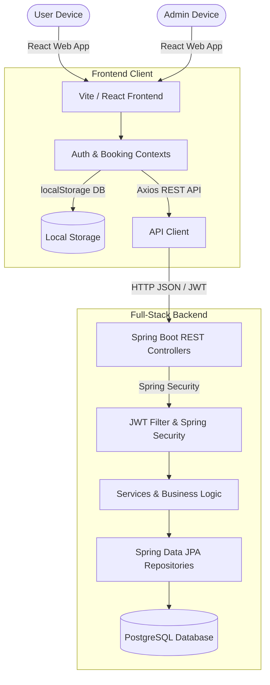
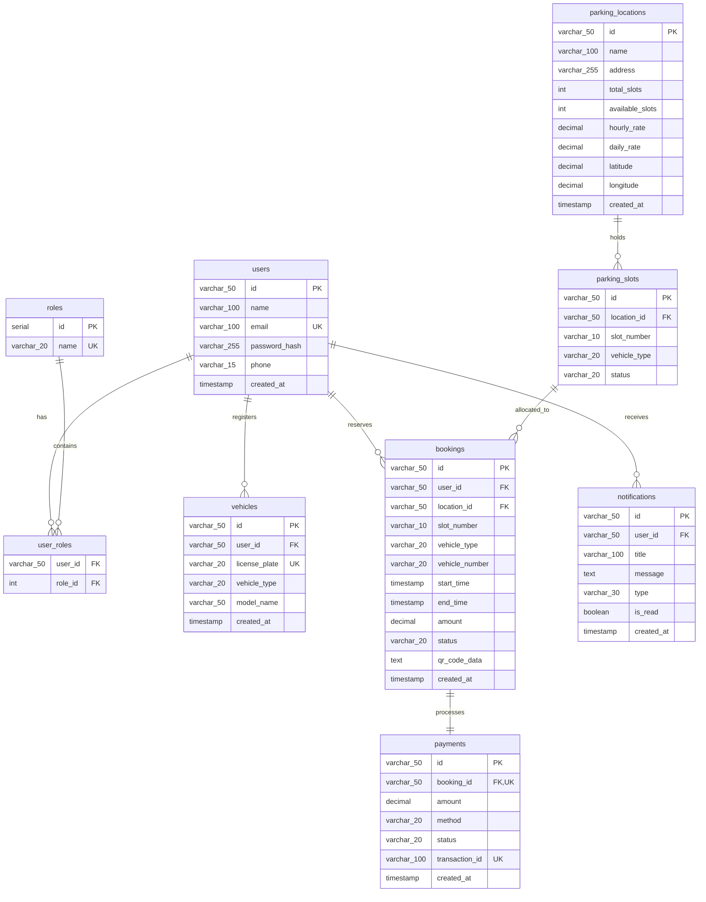
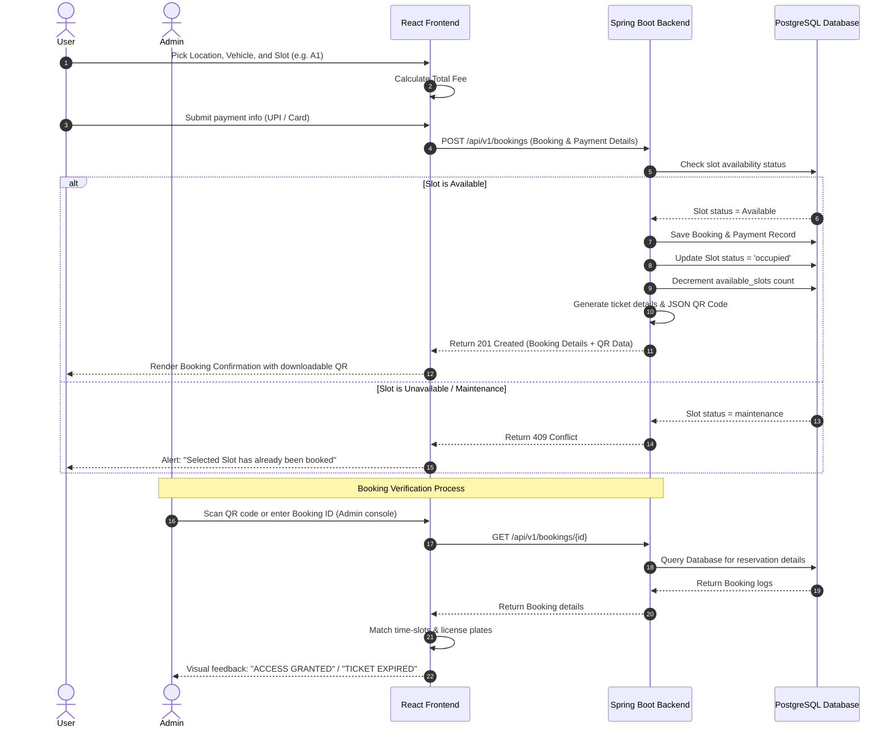

# Project Documentation: Smart Parking Management System (College Final Year Project)

This document contains the System Requirements Specification (SRS), Relational Database Schema, ER & Sequence Diagrams, and Installation Guides required for your final year college evaluation.

---

## 1. Software Requirements Specification (SRS)

### 1.1 Scope
The **Smart Parking Management System** is a responsive web application that streamlines vehicle slot reservation and management. The system is designed with a **Dual-Mode architecture**:
- **Mock Mode (Default):** Runs entirely client-side using `localStorage` as a mock DB, making it extremely easy to showcase and run on any presentation machine.
- **API Mode:** Integrates with a Java Spring Boot backend and PostgreSQL database, demonstrating enterprise full-stack development skills.

### 1.2 System Actors
1. **User (Driver / Vehicle Owner):**
   - Register an account, log in, manage vehicle details.
   - Search parking plazas, view live slot availability grids.
   - Reserves slots and pays simulated transactions.
   - Downloads/prints e-tickets containing a secure QR code.
   - Views history, cancels upcoming reservations.
2. **Admin (Facility Manager):**
   - Monitors general analytics dashboard (Revenue, users, parking rates, active bays).
   - Manages parking locations (Create, Read, Update, Delete).
   - Oversees bays/slots status (forces Maintenance status to block slot booking).
   - Validates tickets using the QR scanner verifier simulator.
   - Extracts business logs as CSV/Excel files and prints daily operations reports.

---

## 2. System Architecture



---

## 3. Database Design (ER Diagram)

The system relies on a PostgreSQL relational database. The diagram below illustrates the schema relationships:



---

## 4. Sequence Diagram: Slot Booking & Verification Flow

This sequence diagram explains how a booking transaction is processed and verified:



---

## 5. Installation & Setup Guide

### 5.1 Prerequisites
- **Node.js** (v18+) & **npm**
- **Java SE Development Kit (JDK 17)**
- **Apache Maven**
- **PostgreSQL Database Server**

### 5.2 Frontend Setup (React)
1. Open terminal in the `project/` directory:
   ```bash
   npm install
   ```
2. Run the local development server:
   ```bash
   npm run dev
   ```
3. Open `http://localhost:5173` in your browser.
4. *Note:* By default, the application runs in **Mock Mode** using `localStorage` data. To switch to the database, open `src/config/api.ts` and set:
   ```typescript
   export const API_MODE = true;
   ```

### 5.3 Backend Setup (Spring Boot)
1. Open PostgreSQL Shell / Admin tool (pgAdmin) and create a database:
   ```sql
   CREATE DATABASE quickpark_db;
   ```
2. Navigate to the `project/backend/` folder.
3. Open `src/main/resources/application.properties` and verify your PostgreSQL credentials:
   ```properties
   spring.datasource.username=postgres
   spring.datasource.password=your_db_password
   ```
4. Build and compile the Spring Boot application using Maven:
   ```bash
   mvn clean install
   ```
5. Run the Spring Boot application:
   ```bash
   mvn spring-boot:run
   ```
   The backend will boot up at `http://localhost:8080/api/v1` and auto-initialize the database using `schema.sql` and `data.sql`.
